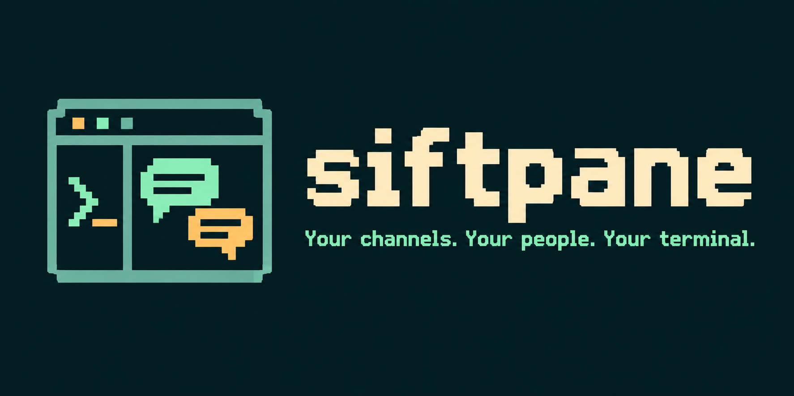

# Siftpane

A focused Slack client for your terminal. Choose the channels, DMs, and group DMs you want to keep close, then read and reply with the keyboard. Siftpane only refreshes conversations you include.

## Try it

Requires Go **1.26.7 or newer**. From this checkout:

```sh
go build -o bin/siftpane ./cmd/siftpane
./bin/siftpane --demo
./bin/siftpane --version
```

The demo runs offline without credentials. It includes distinct conversations, unread activity, older messages, threads, and a simulated send failure you can try by sending `/fail`.

To install the command on your Go binary path:

```sh
go install ./cmd/siftpane
siftpane --demo
```

## Connect Slack

Siftpane currently supports one workspace through your own internal Slack app.

1. Follow the [Slack setup guide](docs/SLACK.md) to create and install the app using the supplied [manifest](slack-app-manifest.yaml).
2. Run `./bin/siftpane --login` and paste your **User OAuth Token** into the hidden prompt. Siftpane saves it in your OS credential store.
3. Run `./bin/siftpane`, press `p`, and choose which conversations to include. Nothing is included automatically.

The live integration is implemented and tested with a fake Slack server. **App installation and live workspace messaging still need verification with authorized credentials.**

## Find your way around

| Key | Action |
| --- | --- |
| `p` | Choose conversations; `Tab` includes or removes an item |
| `/` or `Ctrl+K` | Search existing conversations by `@person` or `#channel`; `Tab` completes |
| `Tab` | Switch sidebar/message focus |
| `j/k` or arrows | Move through conversations or messages |
| `i` | Start composing |
| `Ctrl+S` | Send; `Enter` inserts a newline |
| `Esc` | Keep your draft and return to navigation |
| `t` | Open the selected message's thread |
| `o` | Load older messages or the next thread page |
| `?` | Open the full keyboard guide |
| `q` | Quit; warns if you have unsent text |

Search opens over a dimmed main view. `Enter` explicitly includes and opens an excluded result; typing or completing a name changes no inclusion. Supported terminals can also deliver `Cmd+K`; see [terminal compatibility](docs/TERMINALS.md#command-k).

Drafts stay with their conversation or thread while you switch, but remain in memory and do not survive exit. Failed sends keep their text. See the [full keyboard and retry guide](docs/USAGE.md).

## What to expect

- Updates arrive through bounded polling, so activity may appear after a delay. Unread dots and the `Siftpane *` window title mean **unread here**, independently of Slack's read position. The title depends on [terminal/multiplexer support](docs/TERMINALS.md#unread-window-title).
- Removing a conversation stops its local refresh and notifications without leaving it in Slack.
- Preferences are saved in your [platform's configuration directory](docs/CONFIGURATION.md). Channel, people and resolved author names are cached separately for faster startup. Messages appear before remaining names finish loading. Tokens and message bodies never go into preferences or the metadata cache.
- Ordinary terminals work without patches. Rounded Unicode frames, bracketed amber focus titles, and a compact layout keep messages readable. See [terminal compatibility](docs/TERMINALS.md).
- This version handles text messaging and threads. It does not include calls, huddles, file uploads, AI features, or a multi-workspace interface.

The [Slack guide](docs/SLACK.md) explains permissions, rate limits, credential recovery, and polling limitations.

## Contribute

Start with the [development guide](docs/DEVELOPMENT.md). Run `make fmt` to format changes and `make check` before submitting them. Tool versions are pinned; no separate linter installation is needed.

[Architecture](docs/ARCHITECTURE.md) · [UI and UX guidelines](docs/DESIGN.md) · [Verification record](docs/VERIFICATION.md) · [Follow-up backlog](docs/BACKLOG.md) · [Changelog](CHANGELOG.md) · [Release guide](docs/RELEASING.md)
